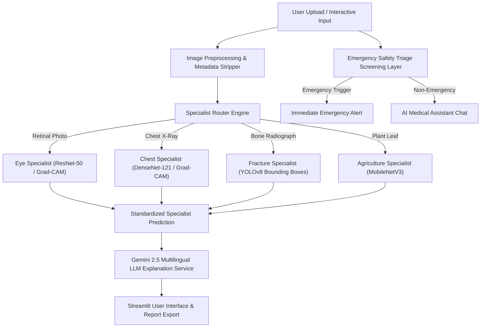

# MediScope AI Architecture Documentation

## Architectural Design Principles
1. **Separation of Model Output and LLM Explanation:** The underlying computer vision model predictions and confidence scores are determined independently and passed as immutable inputs into Gemini. The LLM explains the findings in plain language; it does not alter recorded numerical confidence values or invented labels.
2. **Modality Verification & Routing:** The `SpecialistRouter` enforces user modality selection or verifies image properties before routing. Arbitrary non-medical images are halted with clear guidance rather than routed to an improper specialist model.
3. **Multi-Model Extensibility:** Model adapters implement `BaseSpecialistModel`, allowing new PyTorch, YOLO, or ONNX models to be registered easily via `configs/models.yaml`.
4. **Independent Triage Layer:** Symptom text is screened against high-risk keywords prior to LLM response generation to prioritize emergency healthcare referral when red-flag symptoms (e.g. chest pain, stroke signs) are detected.
